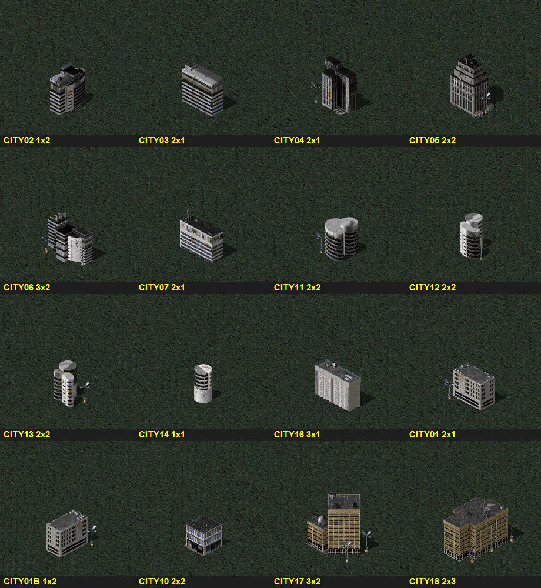

# Nowoczesne budynki miejskie (bloki, biurowce, wieżowce) do misji

Zestaw budynków DTA do nowoczesnego miasta na mapach misji (teatr Temperate): seria `CITY*`. Użytkownik wybrał go 2026-10-27 jako zapas na przyszłe misje (od misji 1), ale **po obejrzeniu w [[missions/arka-05-tarsonis]] (2026-10-28) odrzucił go tam: „to nie pasuje za bardzo”**. W miastach światów StarCrafta lepiej sprawdzają się budynki Terran SC (Supply Depoty, budynki z przybudówkami, dzielnice tematyczne, zob. ARKA 5). Ten katalog to tylko ściąga, gdyby misja potrzebowała miasta „ziemskiego”. **Przed użyciem zapytać użytkownika.**

Źródła: `INI/Rules.ini` (`[BuildingTypes]`, sekcje `CITY*`, `CA*`, `NV*`, `V20–V37`), `INI/Art.ini` (`Foundation`, `Theater=yes`/`NewTheater=yes`), rendery CNCMaps na płaskiej mapie Temperate z `tools/build-bldg-sheet.ps1`.

## Zestaw

| Rodzaj | Typy (fundament) | Uwagi |
|---|---|---|
| Wieżowce i biurowce | `CITY04` szklana wieża (2×1), `CITY05` wieżowiec (2×2), `CITY02` zaokrąglony biurowiec (1×2), `CITY03` (2×1), `CITY07` (2×1), `CITY06` kompleks (3×2) | główna zabudowa wokół placów |
| Okrągłe wieże | `CITY11`, `CITY12`, `CITY13` (2×2), `CITY14` (1×1) | pasują do science fiction |
| Bloki mieszkalne | `CITY16` długi blok (3×1), `CITY01` (2×1), `CITY01B` (1×2), `CITY10` pawilon (2×2) | dalej od centrum |
| Starsze, ceglaste | `CITY17` (3×2), `CITY18` (2×3) | „stare miasto”, oszczędnie |

Nazwy w grze: m.in. `CITY03` „Office Building”, `CITY06` „YEO-CA Cola Corp.”, `CITY12` „Bostic Tower”, `CITY14` „Business Offices”, `CITY15` „2nd National Bank”, `CITY16` „Highrise Hotel”. Art: `Theater=yes` (osobne SHP na teatr, Temperate działa).

## Czego nie brać

- `CITY08`, `CITY09`, `CITY15`, `CITY19–22`: kiosk, mały dom, magazyn, przystanki, kościół. Drobnica, nie bloki.
- `CA0001–CA0021` (TS, `NewTheater=yes`): zbiorniki, anteny, panele słoneczne, wieże obserwacyjne. Przemysł TS, nie miasto. Arkusz: `img/city-ca-all.png`.
- `NV01–NV19`: wiejskie domy, stodoły, kościół. `V20–V37`: budynki **pustynne**, na Temperate z popsutą paletą (`V37` „Westwood Executive Building” też). Arkusz: `img/village-nv-v20.png`.
- `V01–V11`: wioska Temperate (używana wcześniej w ARKA 5 zamiast bloków).
- `PARS09` (pałac paryski 4×3), `ARCO`: nie pasują.

## Jak używać w misji

- **Dom:** dom miasta sojuszniczy z graczem i wrogi Zergom (w ARKA 5 `Allies1`, ten sam co obrońcy Konfederacji). Wtedy desant z rozkazem `0,2` (atakuj budynki) rozbiera miasto, a gracz ich nie ostrzeliwuje. Dom `Neutral` wystarcza tylko na dekorację.
- HP 150–250 z 256, żeby miasto wyglądało na zniszczone.
- Stawiać przez `Place-AtWp` z przesunięciem od placu. Generator ARKA 5 omija kafle `Paved Road`, więc bloki nie zasłaniają ulic.
- Podgląd dowolnych typów: `powershell -NoProfile -File Modding\tools\build-bldg-sheet.ps1 -Types CITY02,CITY03 -Name test -Cols 4` → `%TEMP%\bldg-sheet\test_sheet.png`.
